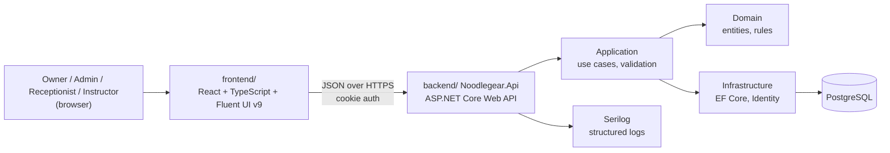
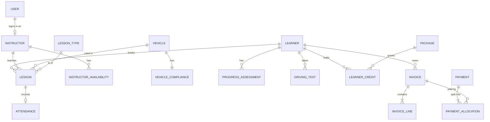

# Noodlegear architecture

**Status:** agreed stack, first draft of the details. Sections marked **Proposed** need the owner's
approval before they are used.

This document describes the technology stack, repository layout, backend structure, data model and
the rules that keep the system correct. It complements the design system docs: for anything visual,
[`AGENTS.md`](../AGENTS.md) and the docs it links are the source of truth.

## 1. Overview

Noodlegear is used by **one driving school** (possibly with several branches). It is built as a
**single deployable application**: one React single-page app, one ASP.NET Core Web API and one
PostgreSQL database. Code is organised by layer and, inside each layer, by feature.

There are no microservices, message brokers or caches. The scale (one school, tens of users) does
not need them, and each adds operational cost.



## 2. Technology stack

| Layer | Technology | Notes |
| --- | --- | --- |
| Frontend | React + TypeScript (strict) + Vite | Full rules in [`AGENTS.md §3`](../AGENTS.md). |
| UI components | Fluent UI React v9 (`@fluentui/react-components`), `@fluentui/react-icons`, `@fluentui/react-datepicker-compat` | The only UI libraries. Not MUI. |
| Styling | Griffel `makeStyles` + Fluent `tokens` + `--ng-*` variables | Generated from `tokens/noodlegear.tokens.json`. |
| Backend | ASP.NET Core Web API on .NET 10 (LTS) | Controllers, one per resource. |
| Data access | Entity Framework Core 10 + Npgsql | Code-first migrations. |
| Database | PostgreSQL 18 | Uses `btree_gist` for booking constraints (§6). |
| Authentication | ASP.NET Core Identity, cookie authentication | Same-origin; no tokens in `localStorage`. |
| Authorisation | Roles + resource-based policies | See §7. |
| Validation | FluentValidation | Errors returned as Problem Details (§8). |
| API documentation | OpenAPI (built-in `Microsoft.AspNetCore.OpenApi`) | Served in Development only. |
| Logging | Serilog | Structured, to console; container collects it. |
| Backend tests | xUnit + Testcontainers (PostgreSQL) | No EF in-memory provider. |
| Containers | Docker + Docker Compose | Local development and deployment. |
| CI | GitHub Actions | Build, test, type check, images. |
| Runtime (frontend tooling) | Node.js 24 (LTS) | |

### Not adding yet

| Technology | Add it when |
| --- | --- |
| Microservices | Never likely for one school. |
| Kafka / message broker | Several systems must react to the same events independently. |
| Redis | A measured, slow query cannot be fixed with indexes or query changes. |
| Kubernetes | More than one server is needed and Compose is no longer enough. |
| MediatR | Not planned. It moved to a commercial licence in 2025; plain service classes are enough. |
| AutoMapper | Not planned. Also commercial since 2025; write mapping by hand. |
| Cloud-specific services | The deployment target is chosen. |

### Proposed (needs approval)

| Concern | Proposal | Why |
| --- | --- | --- |
| Routing | React Router | Standard for React SPAs; needed for list → detail → form pages. |
| Server state | TanStack Query | Caching, loading and error states for API data; maps to the design system's loading/empty/error states. |
| API types | Generate TypeScript types from the OpenAPI document (e.g. `openapi-typescript`) | Keeps frontend and backend contracts in sync. |
| Frontend tests | Vitest + Testing Library + axe | Unit/component tests and automated accessibility checks (WCAG 2.2 AA is a requirement). |

## 3. Repository layout (monorepo)

Frontend and backend live in one repository. The design system specification stays at the root
because both humans and agents read it for frontend work.

```
Noodlegear/
├── AGENTS.md, CLAUDE.md, README.md
├── docs/                       # design system docs + this document
├── tokens/
│   └── noodlegear.tokens.json  # visual source of truth (frontend build reads it)
├── frontend/                   # Vite React app
│   ├── package.json
│   ├── vite.config.ts          # dev proxy: /api → backend
│   └── src/
│       ├── design-system/      # see AGENTS.md §5
│       ├── features/           # learners/, instructors/, lessons/, vehicles/, billing/, tests/, reports/
│       └── app/                # routing, providers, shell wiring
├── backend/
│   ├── Noodlegear.sln
│   ├── src/
│   │   ├── Noodlegear.Api/
│   │   ├── Noodlegear.Application/
│   │   ├── Noodlegear.Domain/
│   │   └── Noodlegear.Infrastructure/
│   └── tests/
│       ├── Noodlegear.UnitTests/
│       └── Noodlegear.IntegrationTests/
├── docker-compose.yml          # db, api, web
└── .github/workflows/          # CI
```

- The paths in `AGENTS.md §5` (`src/design-system/…`) are relative to `frontend/`.
- Each side has its own tooling (`npm` in `frontend/`, `dotnet` in `backend/`). No monorepo build
  tool (Nx, Turborepo) is needed for two apps.
- Commit messages and pull requests can touch both sides when a feature needs it; keep each change
  to one feature.

## 4. Backend structure

### Layers

| Project | Contains | May reference |
| --- | --- | --- |
| `Noodlegear.Domain` | Entities, value objects, enums, domain rules. No framework code. | nothing |
| `Noodlegear.Application` | Use-case services, request/response DTOs, validators, interfaces (e.g. `IClock`). | Domain |
| `Noodlegear.Infrastructure` | `DbContext`, EF configurations, migrations, Identity, implementations of Application interfaces. | Application, Domain |
| `Noodlegear.Api` | Controllers, auth setup, middleware, Problem Details, OpenAPI, composition root. | Application, Infrastructure |

The arrow points inwards: Domain knows nothing about EF Core, HTTP or PostgreSQL.

### Feature folders

Inside `Application`, `Api` and `Infrastructure/Configurations`, code is grouped by feature, matching
the frontend's `features/` folders and the navigation in [`patterns.md §2`](patterns.md):

```
Noodlegear.Application/
├── Learners/        LearnerService.cs, CreateLearnerRequest.cs, CreateLearnerValidator.cs, LearnerDto.cs
├── Instructors/
├── Lessons/         # scheduling, availability, attendance
├── Vehicles/
├── Billing/         # invoices, payments, packages
├── Tests/           # driving tests
├── Reports/
└── Common/          # paging, errors, IClock, ICurrentUser
```

Keep a feature's code together. A feature may call another feature's service; it never reaches into
another feature's tables directly through its own queries.

## 5. Domain model

### Entities

| Entity | Purpose | Key fields |
| --- | --- | --- |
| Learner | A person learning to drive. | display ID `L-10234`, name, contact, date of birth, provisional licence number, status |
| Instructor | Teaches lessons. Linked to a `User`. | display ID `I-021`, name, contact, ADI number, status |
| Vehicle | A school car. | registration, make/model, transmission, status |
| VehicleCompliance | Dates that take a car off the road if missed. | MOT due, insurance expiry, service due |
| LessonType | What can be booked, and its price. | name, default duration, price |
| Lesson | One booked slot. No separate "booking" table. | learner, instructor, vehicle, lesson type, starts at, ends at, status |
| Attendance | What happened at a lesson. | lesson, status, note |
| InstructorAvailability | Working hours and absences. | instructor, weekday/time ranges, absence ranges |
| ProgressAssessment | A learner's level on a skill. | learner, skill, level, assessed at, instructor |
| DrivingTest | A practical test booking and its result. | learner, date, centre, status |
| Package | A bundle of lessons sold at a price. | name, lesson count, price |
| LearnerCredit | Prepaid lessons a learner has left. | learner, package, remaining |
| Invoice + InvoiceLine | What a learner owes. | number `INV-2026-0142`, issue date, due date, status, lines |
| Payment + PaymentAllocation | Money received, and which invoices it pays. | amount, method, received at, status |
| User, Role | Sign-in and permissions (ASP.NET Core Identity). | |
| AuditEntry | Who changed what, when. | user, entity, action, before/after, at |
| Branch (optional) | A school location, if there is more than one. | name, address |



### Statuses

Status values are **exactly** those in `tokens/noodlegear.tokens.json → status.domains`, so the
backend and the UI's status badges always agree. Store them as strings (readable in the database and
logs). A new status is added to the registry first (AGENTS.md §4.5), then to the backend enum.

| Domain | Values |
| --- | --- |
| learner | `enquiry`, `active`, `onHold`, `testReady`, `passed`, `withdrawn` |
| instructor | `available`, `onLesson`, `onLeave`, `inactive` |
| lesson | `scheduled`, `inProgress`, `completed`, `cancelled`, `noShow`, `rescheduled` |
| payment | `paid`, `partiallyPaid`, `pending`, `overdue`, `refunded`, `void` |
| invoice | `draft`, `issued`, `paid`, `overdue`, `void` |
| test | `notBooked`, `booked`, `passed`, `failed`, `cancelled` |
| vehicle | `available`, `inUse`, `serviceDue`, `offRoad`, `retired` |
| attendance | `present`, `late`, `absent`, `excused` |

Some statuses are **derived**, not stored: `instructor.onLesson` and `vehicle.inUse` come from the
schedule at the current time; `overdue` comes from the due date. Compute them in queries so they can
never go stale.

### IDs

- Primary keys are `uuid` (or `bigint`; choose once and use everywhere). They are never shown to users.
- Display IDs follow [`patterns.md §12`](patterns.md): `L-10234`, `I-021`, `INV-2026-0142`. They come
  from PostgreSQL sequences and are unique. Invoice numbers restart each year and must have no gaps.

## 6. Business rules enforced by the database

Rules that must never be broken are enforced by PostgreSQL, not only by C# code. Application checks
give friendly messages; the database guarantees correctness when two people act at the same moment.

### No double-booking

An instructor, a vehicle and a learner can each be in only one active lesson at a time:

```sql
CREATE EXTENSION IF NOT EXISTS btree_gist;

ALTER TABLE lessons ADD CONSTRAINT lessons_no_instructor_overlap
  EXCLUDE USING gist (instructor_id WITH =, tstzrange(starts_at, ends_at) WITH &&)
  WHERE (status NOT IN ('cancelled', 'rescheduled'));
-- same pattern for vehicle_id and learner_id
```

The API catches the constraint violation and returns `409 Conflict` with a message such as
"Sam Patel already has a lesson from 14:00 to 15:00." Add these constraints with raw SQL in an EF
migration.

### Money

- Amounts are `numeric(12,2)` in the database and `decimal` in C#. Never `float`/`double`.
- Currency is GBP (one setting). Formatting happens only in the frontend's shared helpers.
- An issued invoice is never edited. Corrections are made by voiding it or issuing a credit.
- A payment is allocated to one or more invoices; an invoice's paid amount is the sum of its
  allocations.

### Time

- Store instants as `timestamptz` (UTC). Send ISO 8601 UTC over the API.
- The school's time zone is one setting, `Europe/London`. Convert for display in the frontend.
- Working hours are local times (e.g. 09:00–17:00) and are converted per date, so clock changes in
  March and October do not shift lessons.

## 7. Security

- **Authentication:** ASP.NET Core Identity with an HTTP-only, secure, same-site cookie. In
  development, Vite proxies `/api` to the backend so the app and API share an origin. Enable
  antiforgery protection for state-changing requests.
- **Roles:** Owner, Admin, Receptionist, Instructor.
- **Resource-based authorisation:** roles are not enough. An instructor may see and update only
  their own lessons and their own learners. Enforce this with authorisation policies checked against
  the specific record, and filter queries by the current user.
- **Audit:** record changes to money, statuses and users in `AuditEntry`.
- **Personal data (UK GDPR):** learner contact details, dates of birth and licence numbers are
  personal data. Collect only what is needed, restrict access by role, and define a retention period
  for withdrawn and passed learners.

## 8. API conventions

- REST resources per feature: `GET /api/learners`, `GET /api/learners/{id}`, `POST /api/learners`,
  `PUT /api/learners/{id}`, and actions as sub-resources (`POST /api/lessons/{id}/cancel`).
- Lists accept `page`, `pageSize`, `sort` and filter parameters, and return items plus the total count
  (the frontend `DataTable` and `Pagination` need both).
- Errors use **Problem Details (RFC 9457)**. Validation errors list field names and messages so forms
  can show them next to the right field ([`patterns.md §5`](patterns.md): validate on submit).
- Dates and times are ISO 8601 UTC; money is a decimal number with the currency implied (GBP).
  The API never formats values for display.

## 9. Testing

| Level | What | Tools |
| --- | --- | --- |
| Domain unit tests | Entity rules (e.g. a cancelled lesson cannot be completed). | xUnit |
| Integration tests | API endpoints against a real PostgreSQL, including the booking constraints. | xUnit, `WebApplicationFactory`, Testcontainers |
| Frontend | Components, hooks, accessibility. | **Proposed:** Vitest, Testing Library, axe |

Do not use the EF Core in-memory provider; it cannot run PostgreSQL constraints and hides real bugs.

## 10. Delivery and operations

- **Local development:** `docker compose up db` for PostgreSQL; run the API with `dotnet run` and the
  frontend with `npm run dev`. `docker compose up` runs all three.
- **Migrations:** create with `dotnet ef migrations add`; apply as a separate deploy step using an EF
  migration bundle. The API does not migrate the database on startup.
- **CI (GitHub Actions):** on every pull request, build and test the backend, and type check, lint,
  test and build the frontend. Build Docker images on `main`.
- **Backups:** nightly `pg_dump` kept off the server, with a restore tested at least once a quarter.
  This database holds payment records.
- **Configuration:** connection strings and secrets come from environment variables or user secrets,
  never from committed files.

## 11. Open decisions

- Approve or replace the **Proposed** items in §2.
- `uuid` or `bigint` primary keys (§5).
- Whether there is more than one branch (adds `Branch` and a branch filter).
- Hosting target for production (a single VM with Docker Compose is enough to start).
