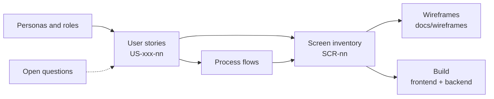

# Noodlegear requirements

Business analysis pack for the Noodlegear Driving School Management System. It describes **who** uses
the system, **what** they need to do, **how** the work flows and **which screens** support it. It is
the input for the wireframes ([`../wireframes/index.html`](../wireframes/index.html)) and for building
the frontend and backend.

**Status:** first draft for the owner's review. Everything marked *Assumption* needs confirmation;
see [open questions](open-questions.md).

| Document | Contents |
|---|---|
| [`roles-and-permissions.md`](roles-and-permissions.md) | Personas (who uses Noodlegear and why) and the permission matrix. |
| [`user-stories.md`](user-stories.md) | Epics and user stories with priorities and acceptance criteria. |
| [`process-flows.md`](process-flows.md) | Business processes and status lifecycles as diagrams. |
| [`screen-inventory.md`](screen-inventory.md) | Every screen: ID, route, page pattern, roles, stories it serves. |
| [`open-questions.md`](open-questions.md) | Assumptions made and decisions the owner needs to take. |

## How the documents connect

## Identifiers

| Prefix | Meaning | Example |
|---|---|---|
| `US-<EPIC>-<nn>` | User story | `US-LES-03` Book a lesson |
| `SCR-<nn>` | Screen | `SCR-20` Schedule |
| `BR-<nn>` | Business rule | `BR-01` No double-booking |
| `Q-<nn>` | Open question | `Q-03` Late cancellation fee |

Epic codes: `AUTH` access, `DSH` dashboards, `LRN` learners, `LES` lessons & scheduling,
`ATT` attendance & progress, `TST` driving tests, `INS` instructors, `VEH` vehicles, `BIL` billing,
`RPT` reports, `SET` settings.

## Priority

MoSCoW, measured against the **first release (MVP)**:

- **Must**: the school cannot run day-to-day without it.
- **Should**: important, in the first release if time allows.
- **Could**: valuable later.
- **Won't (now)**: explicitly out of scope for the first release.

## Scope of the first release

**In scope:** staff-facing web app for one school (optionally several branches); learners,
instructors, vehicles, lesson scheduling, attendance and progress, driving tests, invoices, payments,
prepaid packages, basic reports, settings and users.

**Out of scope (first release):** a learner-facing portal or app and online self-booking; card
payment processing inside Noodlegear (payments are recorded, not taken); SMS sending (email only);
instructor payroll; accounting-system integration; theory-test preparation content. See
[open questions](open-questions.md) for items that may move into scope.
