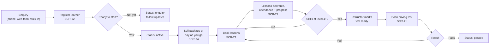
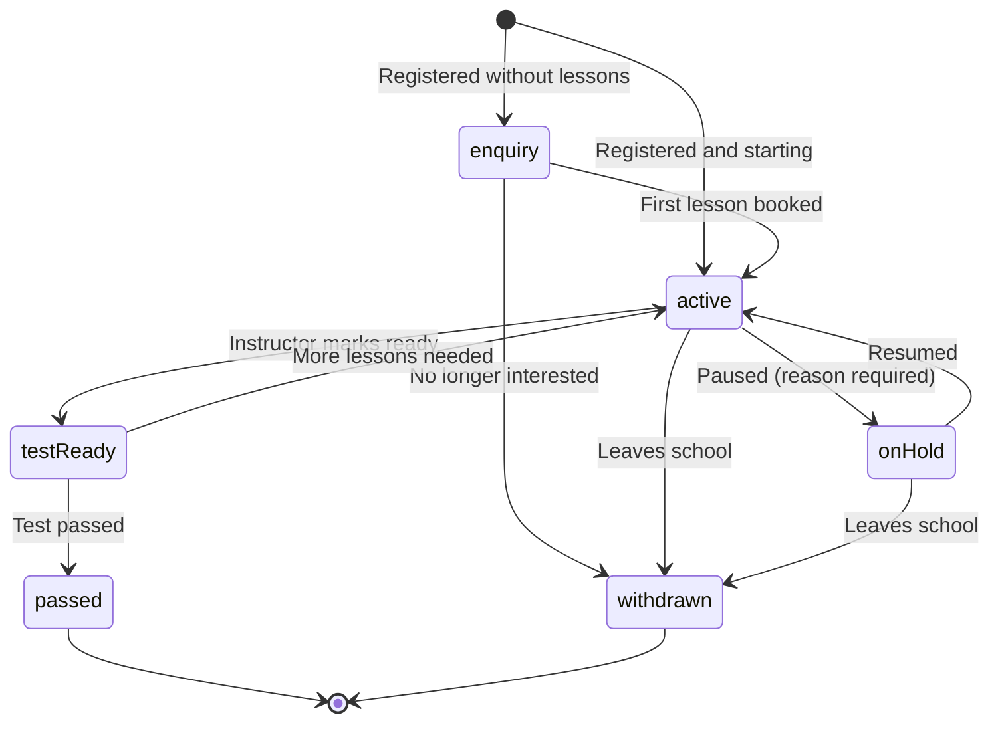
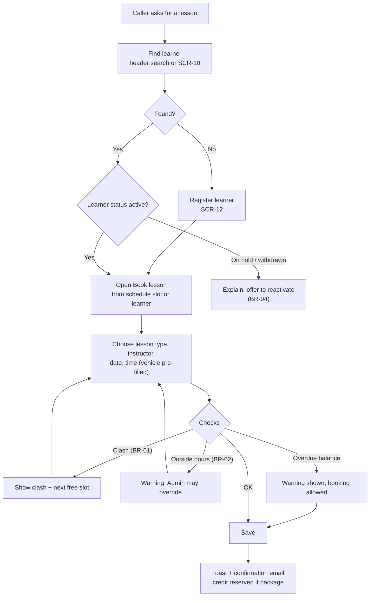
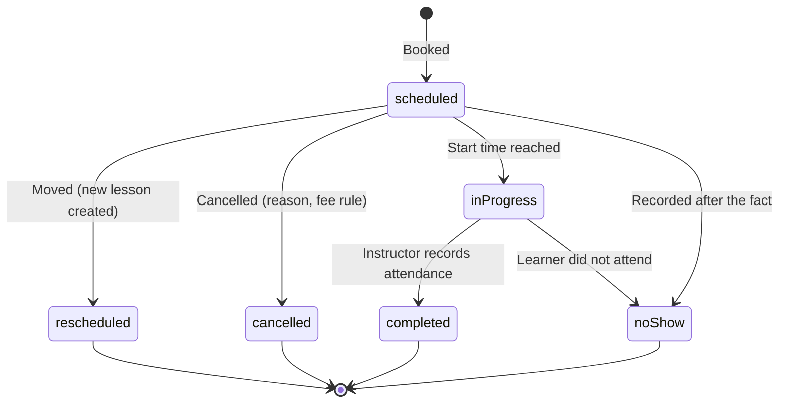
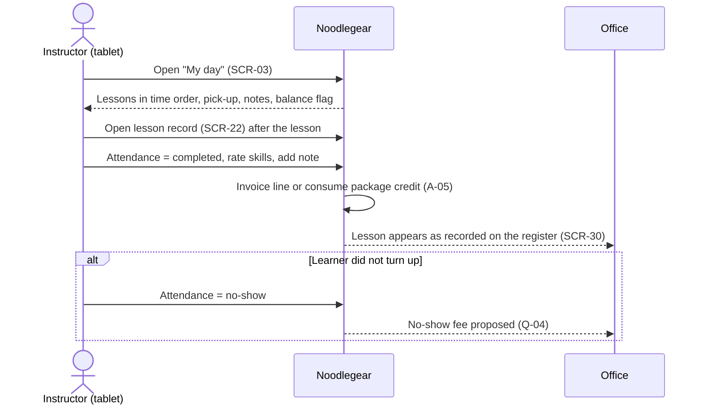
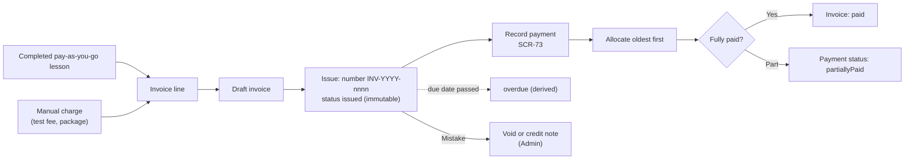
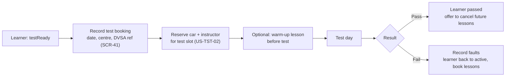
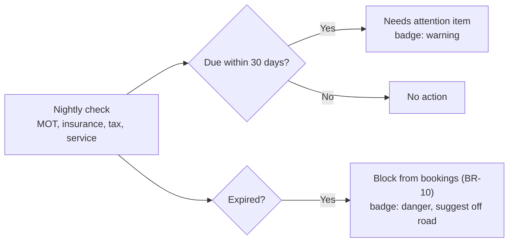

# Process flows

How work moves through Noodlegear. Diagrams are Mermaid (they render on GitHub). Status names match
`tokens/noodlegear.tokens.json → status.domains` exactly.

## 1. Learner journey (end to end)

## 2. Learner status lifecycle

## 3. Booking a lesson (reception, while on a call)

## 4. Lesson lifecycle

`inProgress` is derived from the clock (not stored); `rescheduled` keeps the history of the original slot.

## 5. Instructor's lesson day

## 6. Invoicing and payment

## 7. Driving test

## 8. Vehicle compliance

---

## Business rules catalogue

| ID | Rule | Enforced in |
|---|---|---|
| BR-01 | An instructor, a vehicle and a learner can each be in only one non-cancelled lesson at any moment. | Database exclusion constraint + API (409 Conflict) |
| BR-02 | Lessons must fall within the instructor's working hours and outside absences (Admin can override). | API validation |
| BR-03 | Bookings start on 15-minute boundaries; minimum length 30 minutes. | API validation |
| BR-04 | Only `active` or `testReady` learners can be booked. | API validation |
| BR-05 | A lesson can be recorded from its start until 7 days after; later changes need Admin. | API authorisation |
| BR-10 | A vehicle with an expired MOT, insurance or road tax cannot be used in a lesson. | API validation |
| BR-11 | An instructor with an expired ADI badge cannot be assigned new lessons. | API validation |
| BR-20 | Instructors see only their own lessons and the learners they teach. | API resource-based authorisation |
| BR-21 | Instructors never see invoice or payment amounts, only a "balance outstanding" flag. | API response shaping |
| BR-22 | Changes to money, statuses and users are audited. | API + database |
| BR-23 | Navigation hides what a role cannot access. | Frontend |
| BR-30 | Money is decimal; issued invoices are immutable; invoice numbers have no gaps. | Database + API |
| BR-31 | Payments are allocated oldest invoice first unless staff choose otherwise; leftovers become learner credit. | API |
| BR-32 | Package credit is consumed on lesson completion, not on booking (released if cancelled). | API |
| BR-40 | All times are stored in UTC and shown in `Europe/London`. | API + frontend helpers |
