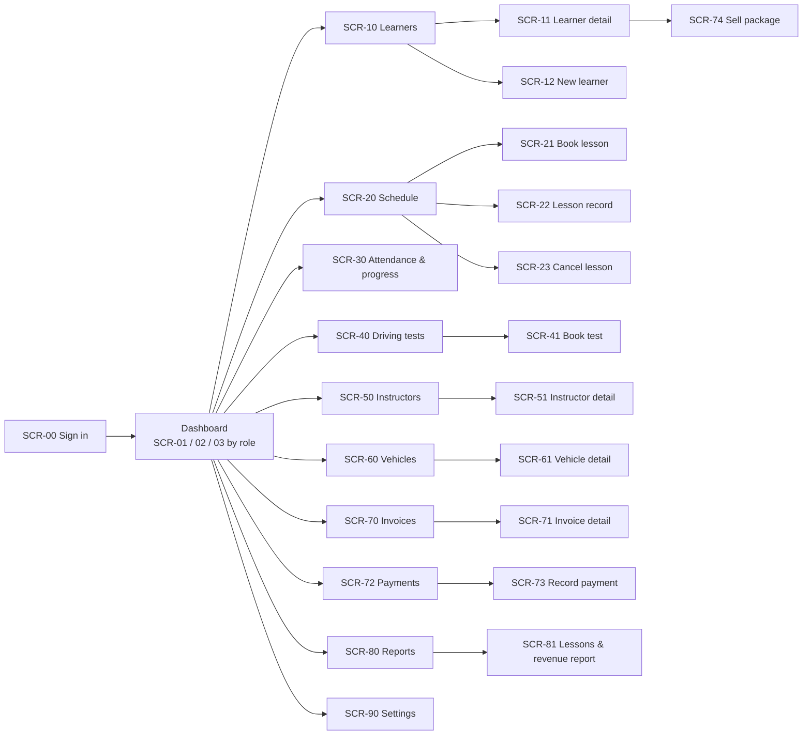

# Screen inventory

Every screen in the first release. The ID is used in user stories, the wireframes and, later, in pull
requests. Page patterns refer to [`../patterns.md §3`](../patterns.md). Open each one in the
wireframes: `docs/wireframes/index.html#/<SCR-id>`.

## Sitemap

## Screens

| ID | Screen | Route | Pattern | Roles | Stories |
|---|---|---|---|---|---|
| SCR-00 | Sign in | `/sign-in` | Sign-in (proposed P-01) | All | AUTH-01, 02 |
| SCR-01 | Dashboard (owner/admin) | `/` | Dashboard §3.4 | Owner, Admin | DSH-01, 04 |
| SCR-02 | Today (reception) | `/` | Dashboard §3.4 | Receptionist | DSH-02 |
| SCR-03 | My day (instructor) | `/` | Dashboard §3.4, tablet-first | Instructor | DSH-03, ATT-01 |
| SCR-10 | Learners list + quick view | `/learners` | List §3.1 + DetailPanel | All (instructor: own) | LRN-02, 03, 04 |
| SCR-11 | Learner detail | `/learners/:id` | Detail §3.2, tabs | All (instructor: own) | LRN-05–09, ATT-05, BIL-04 |
| SCR-12 | New / edit learner | `/learners/new` | Form §3.3 | Owner, Admin, Receptionist | LRN-01, 10 |
| SCR-20 | Schedule (day by instructor / week) | `/lessons` | Schedule §3.6 | All (instructor: own) | LES-01, 02, 04, 10 |
| SCR-21 | Book / reschedule lesson | dialog | Dialog (medium) | Owner, Admin, Receptionist | LES-03–07 |
| SCR-22 | Lesson record | `/lessons/:id` | Form §3.3, tablet-first | All (instructor: own) | ATT-01–03, LRN-07 |
| SCR-23 | Cancel lesson | dialog | ConfirmDialog | Owner, Admin, Receptionist | LES-08 |
| SCR-30 | Attendance & progress | `/progress` | List §3.1, tabs | Owner, Admin, Receptionist | ATT-04, 05 |
| SCR-40 | Driving tests | `/tests` | List §3.1 | All (instructor: own) | TST-01, 03 |
| SCR-41 | Book driving test | dialog | Dialog (medium) | Owner, Admin, Receptionist | TST-01, 02 |
| SCR-50 | Instructors list | `/instructors` | List §3.1 | Owner, Admin, Receptionist (read) | INS-01, 04 |
| SCR-51 | Instructor detail + availability | `/instructors/:id` | Detail §3.2, tabs | Owner, Admin; instructor: own | INS-02, 03, 05 |
| SCR-60 | Vehicles list | `/vehicles` | List §3.1 | All (read for some) | VEH-01, 02 |
| SCR-61 | Vehicle detail | `/vehicles/:id` | Detail §3.2 | Owner, Admin (edit) | VEH-02–04 |
| SCR-70 | Invoices list | `/invoices` | List §3.1 | Owner, Admin, Receptionist | BIL-01, 02, 07 |
| SCR-71 | Invoice detail | `/invoices/:id` | Detail §3.2 | Owner, Admin, Receptionist | BIL-02, 05, 06 |
| SCR-72 | Payments list | `/payments` | List §3.1 | Owner, Admin, Receptionist | BIL-03, 08 |
| SCR-73 | Record payment | dialog | Dialog (medium) | Owner, Admin, Receptionist | BIL-03 |
| SCR-74 | Sell package | dialog | Dialog (medium) | Owner, Admin, Receptionist | BIL-04 |
| SCR-80 | Reports | `/reports` | List of reports | Owner, Admin | RPT-02–05 |
| SCR-81 | Lessons & revenue report | `/reports/lessons-revenue` | Report (table + one chart) | Owner, Admin | RPT-01, 05 |
| SCR-90 | Settings | `/settings` | Settings §3.5 | Owner, Admin | SET-01–06, AUTH-04 |

## States every screen must show

Per [`patterns.md §8`](../patterns.md): loading (skeleton), empty first-use, empty no-results,
error, and no-permission. The wireframes include a **State** switcher for the list screens so each
state can be reviewed.
